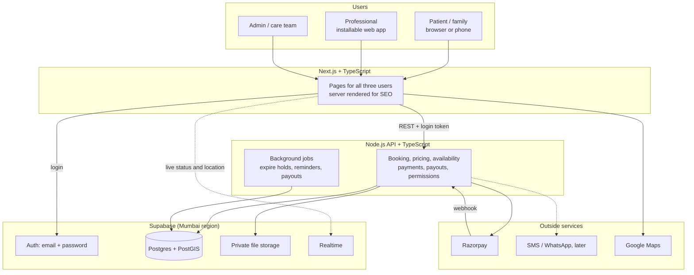
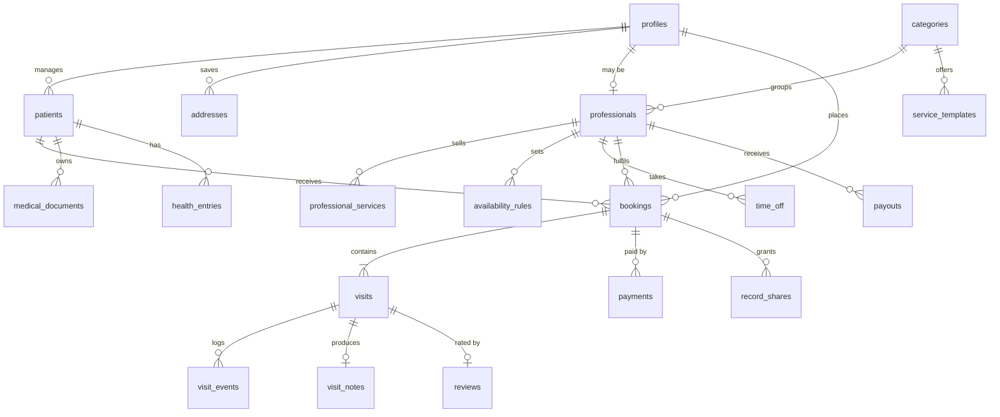
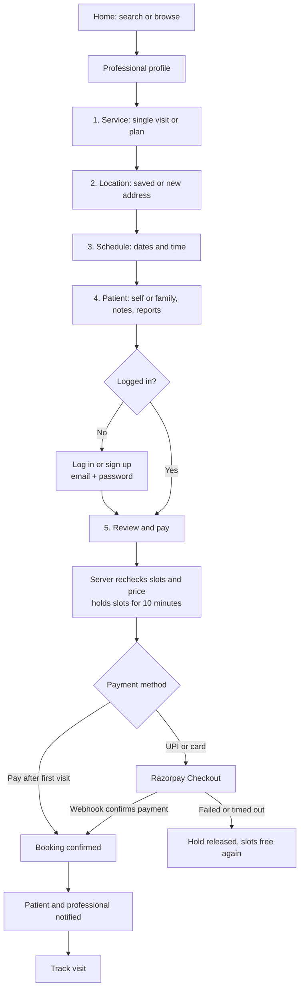
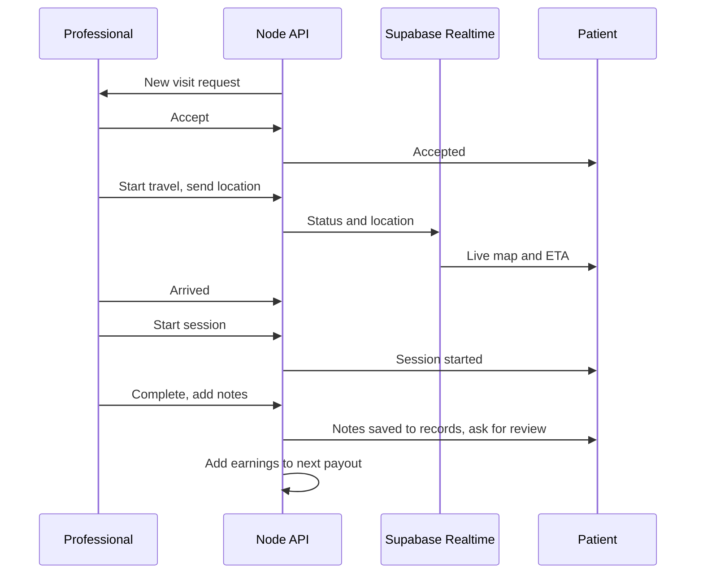
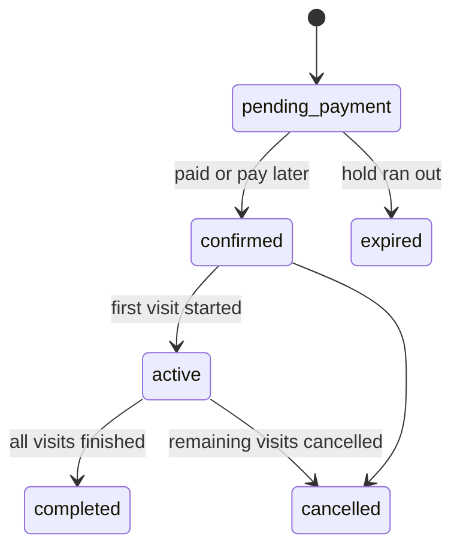
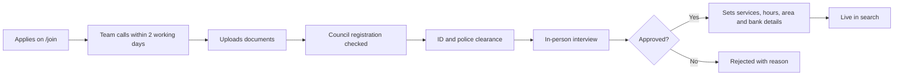
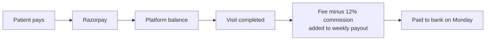

# Medico To Home: Architecture & Project Flow

**Status:** Draft for confirmation. No code has been written yet.
**Source:** the prototype `index.html` in the parent folder.
**Stack requested:** Next.js + TypeScript, Node.js backend, Supabase.

Please review section 11 first. It lists the decisions that need your answer.

### Current build status

Built and connected to Supabase: catalogue, search, real current location, login, bookings, cancellation, reviews, family records, private file uploads, the professional app, and the admin dashboard with content editing.

Changes from the plan below:

- **Row Level Security:** on for every table with no policies, so the browser keys can read nothing. All data goes through the Node API, which checks who is asking.
- **Live tracking:** the patient page refreshes visit status every 8 seconds instead of using Supabase Realtime. There is no live GPS or map yet.
- **Patient details at booking:** report uploads moved to the account page.

Run locally with `npm run dev`. Database changes use `npm run db:migrate`, and demo data uses `npm run db:seed`.

### Temporary choices for the first version

| Item | For now | Added before public launch |
|---|---|---|
| **Slots** | Dummy slots: the prototype's 11 daily times, with free and busy times made up by code. Professionals cannot set their own hours yet. A slot someone has really booked still shows as taken. | Real weekly hours and time off (Phase 9) |
| **Login** | Email + password. The user types their email first; the app checks if it is new and shows either Password or Create password. Email addresses are not verified, and forgotten passwords are reset by an admin. | Verified sign-in and password reset (Phase 9) |
| **Visit start** | No OTP at the door. The professional taps "Start session". | 4-digit visit OTP (Phase 9) |
| **Notifications** | In-app only, because SMS needs DLT registration | SMS / WhatsApp (Phase 9) |
| **Payments** | Razorpay details are coming later and are not needed to start. Phases 0 to 3 run without them. | Razorpay test mode (Phase 4) |

A password is still needed because anyone who types a mobile number could otherwise open that person's medical records.

---

## 1. What the product is

Medico To Home is a marketplace for healthcare at home in Kozhikode and Malappuram (Kannur is planned for early 2027). Families find a verified professional, book one visit or a treatment plan, pay, track the visit live, and keep the family's medical records in one place.

There are three kinds of user:

| User | What they do | In the prototype? |
|---|---|---|
| **Patient / family** | Search, book, pay, track, manage records | Yes |
| **Professional** | Set hours, accept visits, share location, add notes, get paid | **No**, only the "Join" marketing page and an application form |
| **Admin / care team** | Verify professionals, manage bookings, refunds, payouts | **No** |

The most important finding: **the prototype shows only the patient side.** The product cannot work without the professional and admin sides, because nobody could accept a visit, send live location, or get verified. This plan adds both.

---

## 2. What the prototype contains

The file is one bundled page. It is a React-style app with mock data and no server. I unpacked it and read all of it.

### Screens

| Prototype view | Contents | New route |
|---|---|---|
| Home | Hero search (what / where / when), category tabs, top rated, available now, browse grid with filters, services, 3D therapy explainer, how it works, testimonials | `/` |
| Professional profile | Bio, services and prices, week availability, service area, reviews, similar professionals | `/professionals/[id]` |
| Booking (5 steps) | Service, Location, Schedule, Patient, Review & pay | `/book/[professionalId]` |
| Booked / tracking | Booking ID, live status, ETA, visit OTP, schedule | `/bookings/[id]` |
| Account | Medical records per family member, bookings, personal details, addresses and payments | `/account/*` |
| About | Story, verification process, FAQ, contact | `/about` |
| For professionals | Earnings estimator, application form | `/join` |
| Pop-ups | Login (phone OTP), SOS, filters | Components on the pages above |

### Catalogue

- **14 professional categories**, grouped into 10 service brands (Doctor, Nurse, Physio, Therapy, Mind, Diet, Lab, Pharmacy, Care, Ambulance).
- **23 localities** (12 in Kozhikode, 11 in Malappuram), each with coordinates and pincode.
- **41 sample professionals** and 6 therapy explainers.
- **Languages:** Malayalam, English, Hindi, Tamil, Arabic.
- **11 daily time slots**, 8:00 AM to 7:30 PM.

### Business rules to carry over exactly

| Rule | Value |
|---|---|
| Service price | Professional's base price × service multiplier, rounded to ₹10 |
| Plan discount | 10% from 10 sessions, 15% from 20 sessions |
| Platform fee | ₹49 per booking |
| GST | 18% on the platform fee only |
| Care plans, price per day | 4 hrs ×0.45, 8 hrs ×0.75, 12 hrs ×1, 24 hrs ×1.8 |
| Plan frequency | Daily, alternate days, weekdays, or custom days |
| Skipped session | Moves to the end of the plan |
| Free cancellation | Up to 4 hours before a visit |
| Commission | 12% |
| Payouts | Weekly, every Monday |
| Quality review | Any professional rated below 4.3 |
| Visit statuses | Accepted, On the way, Arrived, In session, Completed |

The page text only mentions the 10% discount, while the code also gives 15% from 20 sessions. Decide which is right (section 11).

### Design system

- **Font:** Inter.
- **Colours:** navy `#02084D` (primary), `#1A2170`, text greys `#4A4F6A` and `#6B7085`, borders `#E6E8EF`, soft backgrounds `#F6F7FA`, green `#1F9D6B` / `#E8F5EF`, red `#D93A3A` / `#FDECEC`.
- **Layout:** mobile changes at 860px, header changes at 1120px.
- **3D body:** a custom Three.js component, moved across as it is and loaded only in the browser.

### What is fake in the prototype

These must never reach real users:

| Fake item | Why it matters |
|---|---|
| Registration numbers | **Generated by a formula, not real.** Showing a false medical registration number on a live site is a serious legal and trust risk. |
| Professionals, ratings, reviews, testimonials | All invented |
| "1,200+ professionals", "4.8 rating", "38 min arrival" | Invented numbers. Replace with real ones or remove. |
| "Insured visits", police clearance claims | Keep only once they are actually true |
| Availability and booked slots | Random, from a formula |
| Patient records (Nihal, Khadeeja, and others) | Sample data |
| Professional photos | Check you have the rights to use them |
| Phone, email and office address | Confirm they are real |

This data goes into a **development-only seed file** and is never loaded into production.

---

## 3. System architecture



### Who does what

| Part | Job |
|---|---|
| **Next.js** | All screens. Public pages are server rendered so Google can find them. |
| **Node.js API** | Every important rule: prices, availability, bookings, cancellations, payments, payouts. |
| **Supabase Postgres** | The main database. PostGIS handles "who covers this location". |
| **Supabase Auth** | Email + password login for now; verified sign-in before launch. |
| **Supabase Storage** | Medical reports and verification documents, in private buckets. |
| **Supabase Realtime** | Pushes visit status and location to the patient's screen. |

### Three rules the build follows

1. **All writes go through the Node API.** The browser never changes a booking, price or payment directly, so nobody can tamper with a price.
2. **The browser reads directly from Supabase only for login and live tracking.** Everything else goes through the API.
3. **The server recalculates the price.** The browser shows an estimate, and the server's number is the one charged.

Row Level Security stays on for every table as a second layer of protection, even though the API checks permissions too. The API uses the logged-in user's token wherever it can. The Supabase service key is used only for webhooks, jobs and admin work, and it never reaches the browser.

---

## 4. Tech stack

| Area | Choice | Why |
|---|---|---|
| Repository | Monorepo with npm workspaces | Web and API share types and pricing code |
| Frontend | Next.js (App Router), TypeScript | As requested |
| Styling | Tailwind CSS with the prototype's colours as tokens | The prototype's inline styles convert cleanly |
| Forms and validation | React Hook Form + Zod | One set of rules, shared with the API |
| Data fetching | TanStack Query | Caching and refresh for booking and account screens |
| Backend | Node.js 22, **Fastify**, TypeScript | Fast, with strong TypeScript and schema support |
| Database access | Supabase client + SQL migrations | Migrations are kept in Git |
| Background jobs | pg-boss (runs on Postgres) | No extra service needed |
| Payments | Razorpay Checkout, Route for payouts | UPI, cards, refunds, built for India |
| SMS (before launch) | MSG91 through Supabase's SMS hook | Works with India's DLT SMS rules |
| Maps | Google Maps Platform | Address pin and location search |
| Testing | Vitest, Playwright | Pricing unit tests, booking flow end-to-end tests |
| Errors | Sentry | Tells us when something breaks in production |

---

## 5. Folder structure

```
medico-to-home-app/
├── ARCHITECTURE.md              this file
├── package.json                 npm workspaces
├── apps/
│   ├── web/                     Next.js
│   │   └── src/
│   │       ├── app/
│   │       │   ├── (public)/    home, professionals, about, join
│   │       │   ├── (patient)/   book, bookings, account
│   │       │   ├── pro/         professional app
│   │       │   └── admin/       admin panel
│   │       ├── components/      ui, home, booking, account, pro, admin
│   │       └── lib/             api client, supabase client, helpers
│   └── api/                     Node.js + Fastify
│       └── src/
│           ├── modules/         catalogue, search, availability, bookings,
│           │                    visits, payments, payouts, records,
│           │                    professionals, reviews, notifications, admin
│           ├── plugins/         auth, errors, rate limiting
│           ├── jobs/            hold expiry, reminders, weekly payouts
│           └── server.ts
├── packages/
│   └── shared/                  types, Zod schemas, pricing and schedule logic
└── supabase/
    ├── migrations/              database changes
    ├── seed/                    demo data, development only
    └── config.toml
```

The pricing and session-date logic lives in `packages/shared`, so the browser estimate and the server's final price always match.

---

## 6. Database design



| Group | Tables | Notes |
|---|---|---|
| Users | `profiles`, `patients`, `addresses` | `patients` is the family (Me, Umma, Uppa and so on). The health profile lives here. |
| Places | `districts`, `localities` | Coordinates stored with PostGIS |
| Catalogue | `categories`, `service_templates`, `therapies` | Editable without code changes |
| Professionals | `professionals`, `professional_services`, `verification_documents`, `applications` | Service area stored as location + radius |
| Availability | `availability_rules`, `time_off` | Weekly hours and exceptions. Added in Phase 9; dummy slots until then. |
| Bookings | `bookings`, `visits`, `visit_events`, `live_locations` | One booking has one or many visits. `visit_otps` is added in Phase 9. |
| Money | `payments`, `refunds`, `payouts`, `payout_items` | Amounts stored as whole paise, never decimals |
| Records | `health_entries`, `medical_documents`, `visit_notes`, `record_shares`, `consents` | Sensitive, see section 9 |
| Feedback | `reviews`, `favourites` | Reviews only from completed visits |
| Operations | `notifications`, `audit_log` | Every read of medical records is logged |

### Preventing double booking

The prototype uses fixed slots, but real visits last from 10 minutes to 12 hours. So each visit stores an actual start and end time, plus travel buffer. A Postgres exclusion constraint then makes it **impossible at database level** for one professional to have two overlapping visits, even if two people book at the same moment.

The prototype also does not check availability for treatment plans at all. The new system checks every date in the plan and shows any clash before payment.

All times are stored in UTC and displayed in India time.

---

## 7. API overview

| Area | Endpoints |
|---|---|
| Catalogue | `GET /categories`, `GET /localities`, `GET /therapies` |
| Search | `GET /professionals?category&lat&lng&date&lang&gender&price&sort`, `GET /professionals/:id` |
| Availability | `GET /professionals/:id/availability?from&to` (returns dummy slots for now, so the screens won't change when real hours arrive) |
| Quote | `POST /quotes` returns server-calculated price and dates |
| Bookings | `POST /bookings`, `GET /bookings`, `GET /bookings/:id`, `POST /bookings/:id/cancel` |
| Visits | `POST /visits/:id/reschedule`, `POST /visits/:id/skip`, `POST /visits/:id/status`, `POST /visits/:id/location`, `POST /visits/:id/notes` |
| Payments | `POST /payments/order`, `POST /webhooks/razorpay` |
| Family and records | `/patients`, `/patients/:id/health`, `/patients/:id/documents` (with signed upload and download links) |
| Account | `/me`, `/addresses`, `/favourites` |
| Reviews | `POST /visits/:id/review` |
| Professional | `/pro/visits`, `/pro/availability`, `/pro/earnings`, `/applications` |
| Admin | `/admin/applications`, `/admin/professionals`, `/admin/bookings`, `/admin/refunds`, `/admin/payouts` |

---

## 8. Project flows

### 8.1 Patient booking



Browsing is open to everyone. The prototype asks for login only from the account pages, so the real flow must also ask for it before payment. Asking at that point keeps browsing friction-free.

### 8.2 The visit



If the professional declines or does not respond in time, the care team is alerted to find a replacement or refund the patient.

### 8.3 Booking and visit status



Each visit moves through: `scheduled → accepted → on_the_way → arrived → in_session → completed`. It can also become `skipped`, `cancelled` or `no_show`.

### 8.4 Becoming a professional



A professional appears in search **only** after an admin approves them. Registration numbers are entered from real documents and checked by a person.

### 8.5 Money



- Refunds are calculated by the server from the 4-hour rule and only for visits not yet done.
- **Pay after first visit:** if the patient pays the professional in cash, the platform's commission and fee are subtracted from that professional's next payout.
- Webhooks are checked for a valid Razorpay signature and are safe to receive twice.

---

## 9. Security and medical data

This app stores health information about patients and their families, so it gets stricter treatment than an ordinary website.

| Topic | How it is handled |
|---|---|
| **Data location** | Supabase in the Mumbai region |
| **Who can see records** | Only the account owner, by default. Row Level Security enforces it. |
| **Sharing with a professional** | Only with the patient's consent, only for that booking, and it ends when the booking ends. This matches the prototype's promise: "Only for this booking." |
| **Family members** | Consent is recorded when adding someone else's health data |
| **Files** | Private buckets, short-lived signed links, no public URLs |
| **Audit** | Every view of medical records is logged |
| **Card details** | **Never touch our server.** The prototype has card and CVV boxes; these are replaced by Razorpay's secure checkout. |
| **Aadhaar** | Do not store Aadhaar numbers. Keep only the verification result, or use a licensed verification provider. |
| **Visit OTP** (Phase 9) | Shown only to the patient, never to the professional. Limited attempts. Until then, nothing proves the professional is really at the door. |
| **Live location** | Sent only during travel, and deleted after the visit |
| **Login abuse** | Rate limits on login attempts, per email and per IP. Email addresses are unverified until Phase 9, so **real patient data must not go in before Phase 9.** |
| **User rights** | Patients can download and delete their data, as India's DPDP Act requires. A Privacy Policy and Terms are needed; both are empty links in the prototype. |

Before launch, have a lawyer check three things:
- Compliance with the DPDP Act for health data.
- Medicine delivery, because selling medicines online is a regulated grey area in India.
- GST treatment, with your accountant, for the fee, the commission, and the medical services.

---

## 10. Build phases

Each phase ends with something you can open and check.

| Phase | Work | Result you can see |
|---|---|---|
| **0. Setup** | Monorepo, Next.js, Fastify, Supabase project, shared package, linting, tests, CI | Empty apps running locally and connected |
| **1. Frontend** | All patient screens rebuilt to match the prototype, still on demo data; 3D body moved across | Looks and behaves like the prototype, with real URLs |
| **2. Data and login** | Database, security rules, email + password login, seed data | Real login; catalogue served from the database |
| **3. Search** | Location, filters, dummy slots | Search works on real data |
| **4. Booking and payment** | Quotes, slot holds, plans, Razorpay test mode, cancellation, refunds | Complete a test booking and payment |
| **5. Professional app** | Application, visit list, accept, earnings, installable web app | A professional can run a visit |
| **6. Live tracking** | Status updates, location, ETA, in-app notifications | Patient watches a real visit move |
| **7. Records** | Family profiles, uploads, visit notes, consent sharing | Full account section |
| **8. Admin** | Verification, bookings, refunds, payouts, reports | Team can run daily operations |
| **9. Launch** | Phone OTP login, visit OTP, real professional hours, SMS / WhatsApp, security review, load test, legal pages, real professionals, go live with Razorpay | Public launch |

**Later, after launch:** in-app chat, native iOS and Android apps (the "Get the app" buttons stay hidden until then), SOS with real dispatch, invoices download, Malayalam interface, Kannur expansion.

**After you confirm this plan, I will start with Phase 0 only.**

---

## 11. Decisions I need from you

Each has my recommendation. If you reply "ok", I will go with these.

| # | Question | My recommendation |
|---|---|---|
| 1 | Separate Node.js API, or put the backend inside Next.js? | **Separate API with Fastify.** You asked for Node.js, and background jobs and webhooks suit a separate server. |
| 2 | Should the professional app and admin panel be included? | **Yes, as sections of the same Next.js app.** The product cannot run without them. |
| 3 | Mobile app for professionals? | **Start with an installable web app.** Limitation: phones usually stop sharing location when the app is in the background, so professionals keep it open while travelling. If this proves a problem, build a small native app. |
| 4 | Payments provider? | **Razorpay.** |
| 5 | SMS provider, needed in Phase 9? | **MSG91.** Not needed for the first version. Indian SMS needs DLT registration, which can take days to weeks and needs your company details, so start it before Phase 9. |
| 6 | Maps provider? | **Google Maps.** It has usage-based costs. |
| 7 | Ambulance and SOS? | **Do not treat emergencies as slot bookings.** For launch, Ambulance is "call now" to a real dispatch number, and SOS always shows Call 112. A person in an emergency should not wait for a booking. |
| 8 | Plan discount? | **Keep 10% from 10 and 15% from 20**, and update the page text to say so. |
| 9 | Who pays for the plan discount? | **Please decide.** If commission is 12% of the discounted price, the professional shares the discount. If the platform funds it, your margin shrinks. My default: commission on the discounted price. |
| 10 | Pay after first visit for long plans? | **For launch, allow it only on single visits and require upfront payment for plans.** The prototype's weekly billing for remaining sessions adds risk of unpaid visits. |
| 11 | Launch with all 14 categories? | **Start with Doctor, Nurse, Physio, Lab and Caregiver.** The system supports all 14 and others can be switched on without code. Pharmacy needs a legal check first. |

I also need these from you when we reach the relevant phase:

- **Now:** a Supabase project, following [SUPABASE_SETUP.md](SUPABASE_SETUP.md).
- **Phase 3:** a Google Cloud account, used only for Google Maps (address pin, location search, live tracking map).
- **Phase 4:** Razorpay test keys.
- **Phase 9:** an MSG91 account.
- Real professionals' details, photos and registration documents.
- Confirmed company contact details, Privacy Policy and Terms.
